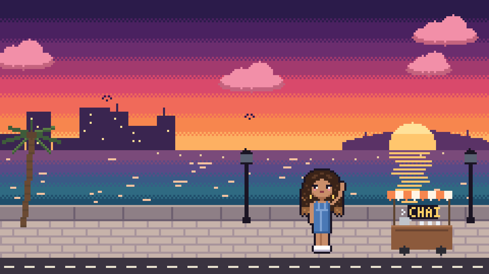
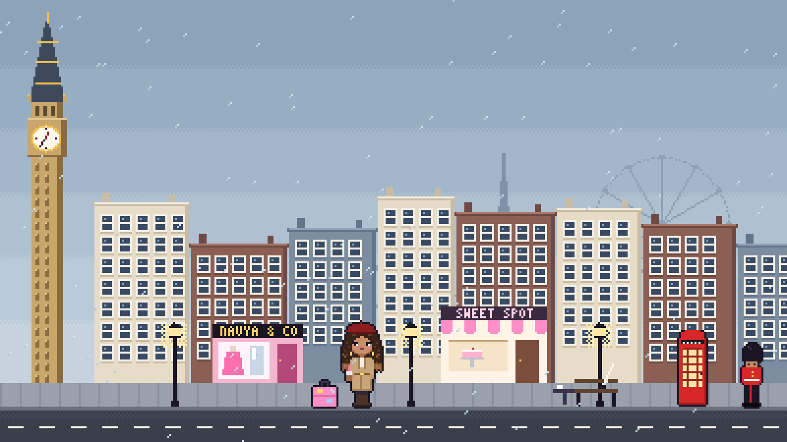
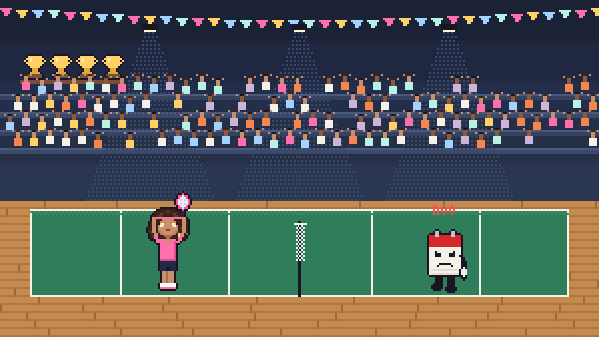
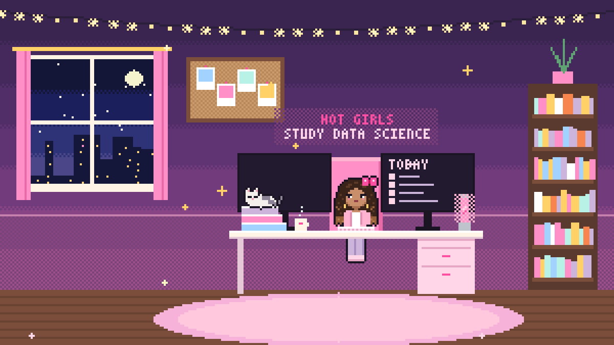
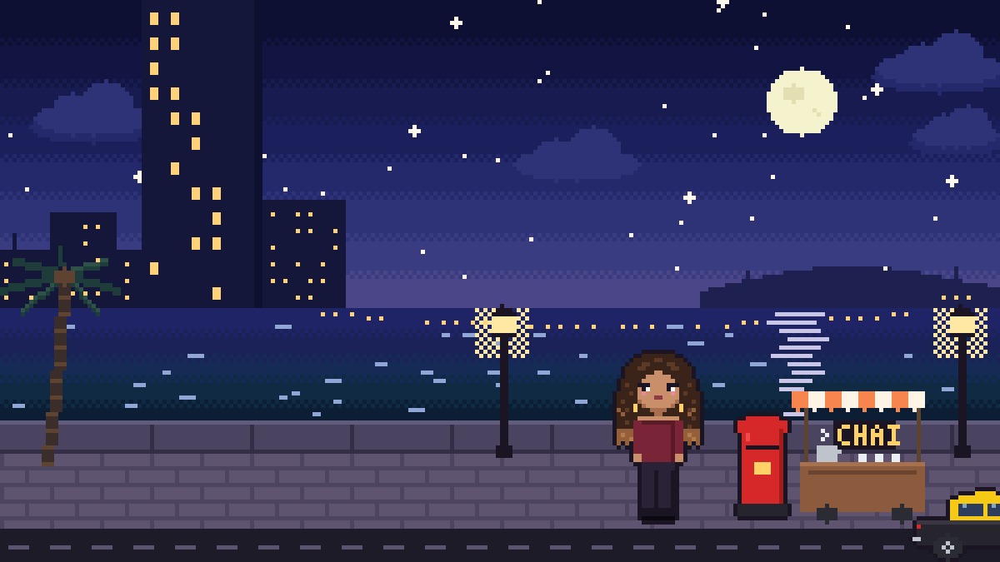

# The NavyaVerse ✿

**A personal website you play through.** The NavyaVerse is a scroll-driven, pixel-art world in the style of an early-2000s handheld game: every section of a portfolio is a level, every transition is a little flight, and the main character answers your questions.

**[navya-shah.vercel.app →](https://navya-shah.vercel.app)**



## The tour

| | |
|---|---|
|  |  |
| **World 1 · London.** Hobbies and interests: a live Big Ben clock, a red bus that drives past as you scroll, clickable shopfronts and an outfit mirror. | **World 2 · The Court.** Projects and experience, presented as a badminton match against a walking deadline. The scoreboard ticks to 21–19 as you scroll. |
|  |  |
| **World 3 · The Study Room.** Education in a pink study room, with a to-do list that fills an "academic validation" meter. | **Home and back again.** It starts and ends on Marine Drive in Mumbai: at sunset when you arrive, at night when you reach the contact page. |

In between: a boarding pass that gets stamped before a flight to London, a parchment scroll that unrolls and writes a poem in calligraphy, a shuttlecock smash and a paper-plane glide.

## Features

- **Hand-made pixel art, drawn in code.** No image files for the scenes. Every character, building and prop is generated at a low resolution and scaled up by whole pixels, so it stays crisp on any screen.
- **One character, many outfits.** Pixel-Navya's poses are drawn once, and each outfit is a palette swap plus a few accessories, the same trick old handheld games used.
- **Scenes that recompose for phones.** A scene is laid out by anchors rather than fixed coordinates, so on a tall phone screen it rearranges itself instead of shrinking.
- **Scroll-scrubbed storytelling.** Each world pins in place while you scroll and its animation follows your scroll position: walking, the bus, the rally, the camera pulling back out of a window.
- **AI-Navya.** Click the speech bubble above her head. Quick questions answer instantly; questions you type are answered by Gemini in Navya's voice, grounded in a short knowledge file and told never to make things up or share private details.
- **Accessible by default.** All content is real HTML text (the canvases are decorative). Keyboard focus is visible, and visitors whose device asks for reduced motion get a still, fully readable page.

## How it works

```
index.html            all of the content, as plain semantic HTML
src/engine/           the pixel engine
  pixel.js            drawing helpers, a 3×5 bitmap font, sprite grids with auto-outline
  stage.js            fits a scene to its box at a whole-number scale, caches static layers
src/sprites/          Navya, props and icons, drawn as code
src/scenes/           one file per world, plus the transitions between them
src/scroll.js         pins each scene and maps scroll position to scene progress (GSAP ScrollTrigger)
src/ui.js             hotspots, dialog box, outfit mirror, to-do list, contact buttons
src/chat/             the speech-bubble chat and its offline answers
api/ask.js            serverless function that calls Gemini, so the API key never reaches the browser
api/_lib/knowledge.js everything AI-Navya knows: edit this to teach her more
```

Each scene is a function that draws into a small canvas from two inputs: `p`, how far you've scrolled through that scene (0 to 1), and `t`, the time (for ambient things like waves, rain and blinking). GSAP tweens `p` as you scroll; the engine redraws only the scenes on screen.

### The chat and the free tier

`api/ask.js` calls **Gemini 3.5 Flash-Lite** with a persona prompt and the knowledge file. Every visitor shares one free-tier quota, so the function caps requests per visitor and for the whole site, and the quick-question chips never call the API at all. If Gemini is unavailable or busy, the chat falls back to pre-written answers instead of breaking.

## Running it locally

Requires Node 20 or newer.

```bash
npm install
cp .env.example .env.local   # add your Gemini API key to .env.local
npm run dev                  # http://localhost:5173
```

The chat works without a key too: it falls back to its pre-written answers.

Two dev-only pages help with the art: `/sprites.html` shows every sprite and outfit, and `/scenes.html?scene=london&p=0.4` renders one scene at a given scroll progress.

## Deploying

The site is built for [Vercel](https://vercel.com): `npm run build` produces the static site in `dist/`, and `api/ask.js` becomes the `/api/ask` function automatically.

1. Import the repository into Vercel (the Vite preset is detected).
2. Add `GEMINI_API_KEY` under **Settings → Environment Variables**. Optionally set `GEMINI_MODEL` to use a different model.
3. Deploy.

## Built with

[Vite](https://vitejs.dev) · vanilla JavaScript · HTML5 Canvas · [GSAP](https://gsap.com) + ScrollTrigger · [Lenis](https://lenis.darkroom.engineering) · [Gemini API](https://ai.google.dev) via `@google/genai` · [Vercel](https://vercel.com)

## Credits

- Words, the poem "Wanderlust" and the ideas behind every world: **Navya Shah**
- Pixel art: drawn in code for this project
- Fonts (SIL Open Font License 1.1, via [Fontsource](https://fontsource.org)): Press Start 2P by CodeMan38, Pixelify Sans by Stefie Justprince, Pinyon Script by Nicole Fally
- Libraries: GSAP (GreenSock standard no-charge license), Lenis (MIT), @google/genai (Apache-2.0), Vite (MIT)
- Built with help from Claude (Anthropic)
